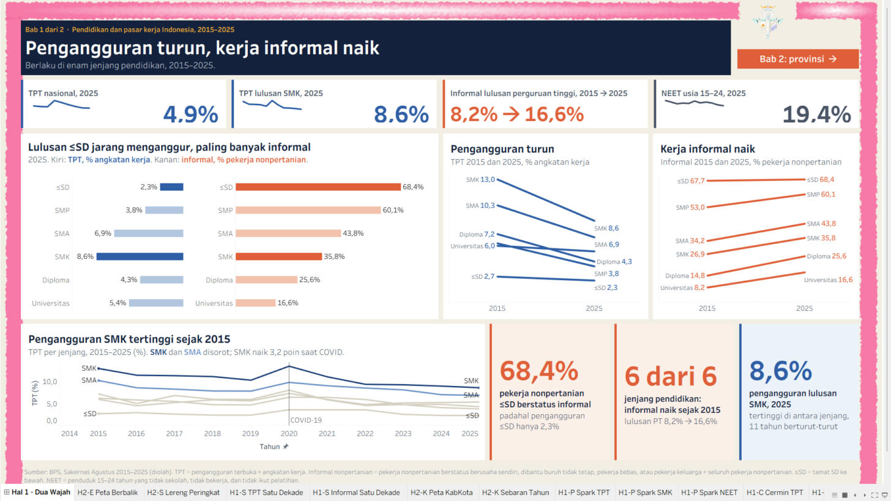
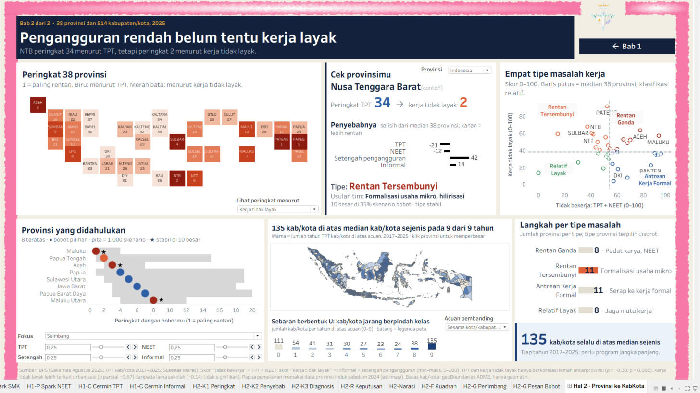
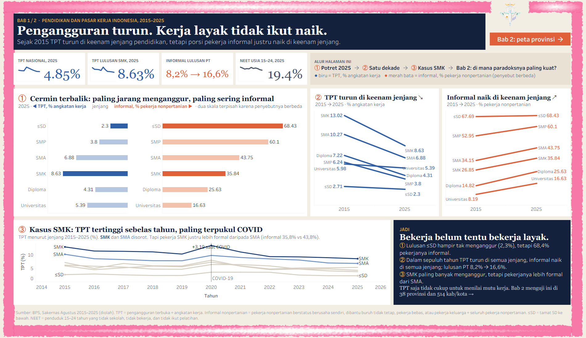
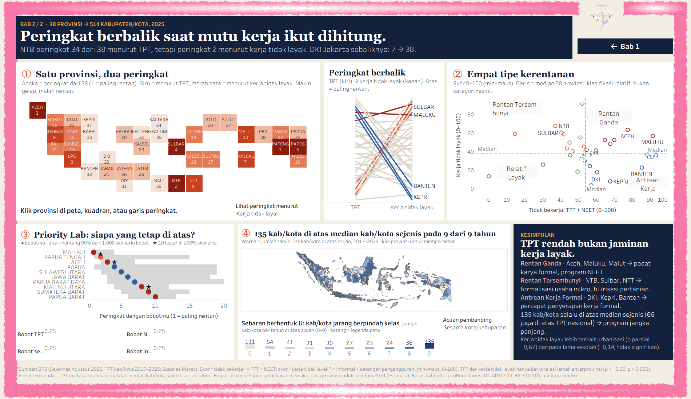

# Progres Tim — Dashboard DAC Tema 4 (per 23 Nov 2026 ±16.50)

## VERSI KUMPUL: v8 → [`DAC_Dashboard_Tema4_v8.twbx`](DAC_Dashboard_Tema4_v8.twbx)
Pakai file ini untuk PDF, Tableau Public, dan ZIP. `DAC_Dashboard_Tema4_FINAL.twbx` (v7c) tetap ada sebagai cadangan.

Yang baru di v8 (dibangun lewat `scripts/redesign_tableau_v8.py` dari v7c, lalu dicek & disimpan di Tableau 2026.3):
- **Hal 2 – Cek provinsimu**: pilih provinsi lewat menu **Provinsi** di kartu *atau* klik peta/kuadran/daftar. Kartu: peringkat TPT → kerja tidak layak, selisih 4 komponen dari median 38 provinsi, tipe + usulan tim. Default "Indonesia" menampilkan NTB (contoh).
- **Fokus kebijakan** di Priority Lab: Seimbang / Kurangi pengangguran / Perbaiki mutu kerja / Anak muda (NEET) / Atur sendiri (slider). Menampilkan 8 teratas.
- **Langkah per tipe masalah** (grafik, menggantikan paragraf kesimpulan) + angka 135 kab/kota.
- **Hal 1**: 3 kartu angka (68,4% · 6 dari 6 · 8,6%) menggantikan kotak "Jadi"; kartu alur dihapus.
- Font Tableau (Georgia dibuang), koma desimal (locale Indonesia), animasi 0,5 dtk, kartu angka berlatar tint + garis aksen kiri, label tile map & kuadran dirapikan.

Sudah diuji di Tableau: NTB 34→2 (35%), DKI 7→38, Papua Tengah 28→1 (87%) lewat menu, Fokus "Perbaiki mutu kerja" (Papua Tengah, Aceh, Maluku, NTB, Sulbar), semua bobot 0 → pesan muncul.
**Belum**: ekspor PDF, publish Tableau Public, ZIP + surat bermeterai.

---
## Arsip ringkasan v7c (23 Nov siang)

Ringkasan untuk anggota tim: sudah sampai mana, apa yang selesai, bentuk dashboard saat ini, dan sisa tugas sebelum **deadline 23 Nov 2026 23.59 WIB**.

## Posisi saat ini
- Platform final **Tableau**. Workbook terkini: [`DAC_Dashboard_Tema4_FINAL.twbx`](DAC_Dashboard_Tema4_FINAL.twbx) (versi **v7c**, 2 halaman, 1900×1100).
- Konsep & semua klaim mengacu ke [`KONSEP_FINAL_DAC_TEMA4.md`](KONSEP_FINAL_DAC_TEMA4.md) (v6). Angka di dashboard sudah dicek ke `Processed_Dataset/tableau/t1–t5`.
- Tampilan akhir (ekspor Tableau 1900×1100):

**Bab 1 — Paradoks di tingkat jenjang pendidikan**

**Bab 2 — Peta kerentanan provinsi & kab/kota**

## Isi dashboard v7c
**Bab 1**
- KPI + sparkline (TPT, TPT SMK, NEET).
- ① *Cermin terbalik*: grafik kupu-kupu dua skala, TPT vs informal per jenjang (≤SD hampir tidak menganggur tapi paling informal; SMK sebaliknya).
- ② Slope satu dekade: TPT turun, informal non-pertanian naik.
- ③ Tren TPT SMK 2015–2025 dengan anotasi COVID.
- Kartu alur bernomor dan kartu "Jadi" (kesimpulan bab).

**Bab 2**
- ① Tile map provinsi "dua kacamata" (TPT ↔ Kerja tidak layak) + slope chart peringkat berbalik (NTB 34→2, DKI 7→38, Kepri 5→37).
- ② Kuadran dua dimensi (label hanya provinsi kunci).
- ③ Priority Lab: 4 slider bobot, 10 provinsi prioritas + stabilitas dari 1.000 skenario bobot.
- ④ Peta 514 kab/kota (poligon geoBoundaries, diizinkan panitia) + histogram "berapa tahun di atas acuan" (bentuk U). Ikut filter Pilih Provinsi & Acuan pembanding.
- Kartu Kesimpulan.

Interaksi: klik provinsi di peta → semua visual ikut; tombol Bab 1 → Bab 2; parameter kacamata, bobot, acuan pembanding.

## Yang sudah selesai
- [x] Data BPS 2015–2025 (WebAPI) + 514 kab/kota 2017–2025, analisis PCA, kuadran, Monte Carlo, persistensi kab/kota, uji forecast.
- [x] Jawaban panitia soal peta (geometri geoBoundaries boleh; data statistik tetap BPS) → [`docs/JAWABAN_PANITIA_PETA.md`](docs/JAWABAN_PANITIA_PETA.md).
- [x] Dashboard Tableau dibangun tim, lalu diaudit & dipoles (22 Nov), kemudian didesain ulang v7 → v7b → v7c (23 Nov).
- [x] Uji interaksi lulus: kacamata TPT↔KTL, klik NTB, klik Jawa Tengah, slider bobot, tombol Bab 1→2.
- [x] Dibuang dari dashboard karena lemah/duplikat (tetap bisa masuk paper): Provinsi Pembanding (gagal uji tandingan), mode cerita "Langkah", heatmap sektor, donut, dumbbell, bar COVID, tabel jejak.

## Sisa tugas (urut prioritas)
1. **Uji sisa**: semua bobot 0 (pesan muncul), klik provinsi Papua baru, Acuan pembanding Nasional ↔ Sesama.
2. **Ekspor PDF 2 halaman** dari FINAL, cek watermark resmi & teks tidak terpotong.
3. **Publish Tableau Public** (pakai akun tim), tempel link di PDF (FAQ 37).
4. **ZIP ≤100 MB**: PDF, FINAL.twbx, Raw_Dataset, Processed_Dataset, Spatial (geojson v7), **surat orisinalitas bermeterai**.
5. Unggah ZIP + PDF di GForm sebelum 23.59 WIB.

Kekurangan kecil yang diketahui: label jenjang kupu-kupu tampil di dua sisi; label "+3,19 saat COVID" menempel garis; label slope Bab 1 dua desimal.

## Perlu diputuskan bersama
- **Palet warna.** Spek di `docs/SPEK_DASHBOARD_TABLEAU.md` (commit 21 Nov) memakai *sky blue + cloudy white + aksen amber red*. Dashboard v7c memakai gaya editorial: kertas/tinta, **biru = TPT**, **merah bata = kerja tidak layak**, font Georgia (palet lolos validator aksesibilitas warna). Pilih salah satu sebelum ekspor PDF; mengganti palet di v7c bisa lewat `scripts/redesign_tableau_v7.py`.

## File penting
| File | Isi |
|---|---|
| `DAC_Dashboard_Tema4_FINAL.twbx` | dashboard terkini (v7c) |
| `DAC_Dashboard_Tema4_BACKUP.twbx` | versi asli buatan tim sebelum dipoles |
| `DAC_desain_QA_v2.twbx` | basis build untuk skrip redesain (jangan dihapus) |
| `scripts/redesign_tableau_v7.py` | skrip redesain v7 (edit XML .twb); cara build ulang di `AI_PROJECT_PROGRESS.md` |
| `Spatial/IDN_kabkota_persistensi_v7.geojson` | poligon kab/kota + atribut persistensi untuk peta Bab 2 |
| `deliverables/REDESAIN_V7_DESIGN_SYSTEM_DAN_QA.md` | design system, audit tiap grafik, hasil QA |
| `deliverables/screenshots/`, `deliverables/qa_redesign/` | tangkapan layar final & tiap putaran QA |
| `AI_PROJECT_PROGRESS.md`, `AI_PROJECT_DECISIONS.md`, `AI_PROJECT_CHANGELOG.md` | log status, keputusan, dan perubahan terperinci |
